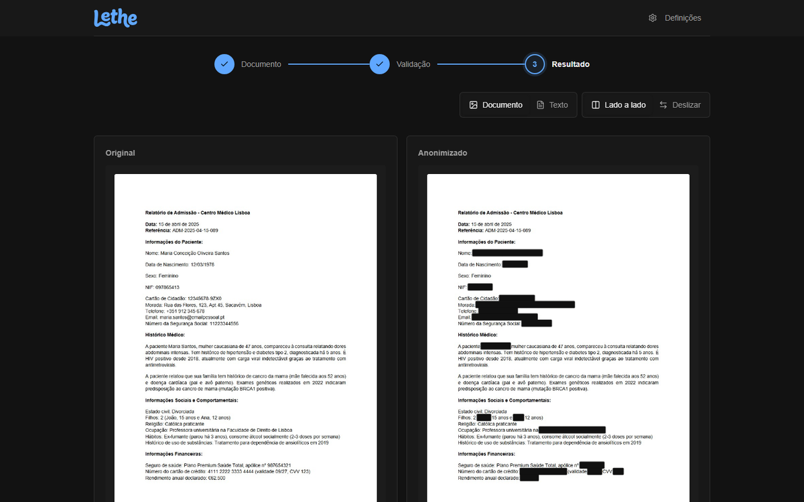

# Lethe: anonymising Portuguese documents with an LLM

Team **Enxada de Pedra** · NOS Gen-AI Hackathon, JunctionX Lisbon 2026

Lethe masks the words that identify a person in a Portuguese document: one `*` per word, the original layout kept, no empty lines. Gemini decides what is sensitive; tested code guarantees the format and checks that nothing it masked is still readable. It reads PDFs (text or scanned), DOCX, photos (PNG, JPG, WebP), TXT and CSV, and can return the original file with the masked words removed for good.


*Left: a photo made from the official PDF (blur, noise, perspective). Right: the file the API returns. Names, date of birth, NIF, ID card, address, phone, email and social security number are removed; sex, ethnicity, age and the medical history stay.*

## Try it

- **Web:** [lethe-nos.vercel.app](https://lethe-nos.vercel.app). Upload a PDF, DOCX, photo, TXT or CSV, review what was masked, then download the text, the report or the redacted file.
- **Android:** [install the APK](https://expo.dev/artifacts/eas/senh9mrlPdfxIErtZ4JFmHEVLVfnFGpDv3ipADKZTIg.apk) (allow installs from outside the Play Store when Android asks).

The web and the app use a demo API that runs on a team computer behind a temporary tunnel during the event, so they may stop answering once it is switched off. Everything also runs locally: see *Run it* below. Use fictitious documents only.

**Start here: [`submission/PROJECT.md`](submission/PROJECT.md)** documents the solution: how it works, the prompt, the privacy rules, setup, usage and the decisions we took.

## Deliverables

| File | What it is |
|---|---|
| [`submission/submission.txt`](submission/submission.txt) | the anonymised official document (52 words masked, one `*` per word) |
| [`submission/prompt.txt`](submission/prompt.txt) | the exact prompt that produced it |
| [`submission/anonimizador/`](submission/anonimizador/) and [`submission/run.py`](submission/run.py) | the code that generates both |
| [`submission/report.md`](submission/report.md) | what was masked and why, with the values hidden |

`submission.txt` and `prompt.txt` are exactly what `python run.py` generates, and a test checks that `prompt.txt` is the prompt the code builds.

## How we evaluated

Every number below was measured on the code in this branch.

| What | How | Result |
|---|---|---|
| Official document | Local replica of the two official metrics (`anonimizador/metric.py`) against a reference we annotated by hand (`submission/data/gold/gold.txt`) | Similarity 100%, Accuracy 100% |
| Stability | The official document regenerated three times with no cache | Identical output every time |
| Leak check | Every masked value searched for again in the output | 0 leaks in 26 values |
| Extra documents | 17 fictitious documents (contracts, emails, records, CSV; PDF, TXT, UTF-16) | 961 words masked, 0 errors; no reference, so counts only |
| Photos | 6 photos made from the official PDF (scan, on a dark table, tilted), through the API, then OCR on the file it returns | All 6 redacted; 0 of the 52 sensitive words still readable |
| Tilt | The same pages turned from -5 to +5 degrees with no page border | OCR reads 306 of 315 sensitive words (251 before the tilt correction) |
| Hostile files | Empty, corrupt, a binary named `.txt`, a 196-megapixel image, a 422 KB DOCX that unpacks to 132 MB, 9 000 words | All refused in under 0.1 s, before any model call |
| Prompt changes | Each wording change run on the official and the 17 extra documents before adoption | One rejected: it fixed two misses but exposed two addresses (see `PROJECT.md`) |
| Tests | pytest, vitest and jest in CI on every push | 215 Python (95% coverage), 55 web, 31 mobile |

Two limits: the hidden reference is unknown, so 100% is against our own annotation, and the photos are simulated, not taken with a phone. One open question is the format of a masked word with punctuation glued to it: `submission.txt` writes `Flores,` as `*,`; if the reference uses a bare `*`, `python run.py --no-keep-punct` gives that form.

## The review interface

The reviewer sees every item highlighted by category with the reason it was masked, can keep any of them visible or mask more, and then compares the original with the anonymised document.




## Run it

```bash
cd submission
pip install -r requirements.txt
cp .env.example .env              # then set GEMINI_API_KEY
python run.py                     # writes submission.txt, prompt.txt and report.md
```

The review interface and the mobile app are optional; their commands are in `PROJECT.md` (section Usage). Photos and scanned PDFs also need [Tesseract](https://github.com/UB-Mannheim/tesseract/wiki) with Portuguese.

## Where to read more

- [`submission/PROJECT.md`](submission/PROJECT.md): the full documentation (English).
- [`submission/api/README.md`](submission/api/README.md): the FastAPI backend, routes and types.
- [`submission/frontend/README.md`](submission/frontend/README.md): the web review interface (Portuguese).
- [`submission/mobile/README.md`](submission/mobile/README.md): the Android and iOS app (Portuguese).
- [`submission/data/test_docs/README.md`](submission/data/test_docs/README.md): the 17 hand-written test documents, the 6 test photos and the generated set of 81 documents with reference answers.

## Team

Pedrom2002, TAF00, RicePerson101 and euick0 (Eric Golovatenko Simões).

---

# Organisers' README

The text below is the original README of the challenge repository, unchanged.

# NOS Gen-AI Hackathon

Welcome to the official repository for the NOS Gen-AI Hackathon, part of the SCAILE initiative! In this repository, you will find essential resources including the official hackathon rules, code snippets, and examples designed to facilitate your development process. Additionally, we provide a baseline structure to guide you in addressing the proposed challenge effectively.

## 0. Problem Statement and Evaluation Criteria

For a complete description of the problem statement and the detailed evaluation criteria, refer to this [document](tutorials/problem_and_eval.md).

The document to be anonymized is located at [`raw_data/document_to_anonymize.pdf`](raw_data/document_to_anonymize.pdf).

## 1. Prerequisites
Before participating in the hackathon, please ensure that you meet the following prerequisites. Having the needed accounts and accesses will help streamline your development process and facilitate the use of necessary tools and APIs.

### 1.1. GitHub Account

Make sure you have an active GitHub account at [Create a GitHub Account](https://github.com/signup)

### 1.2. Google Account

You'll need an active Google account to access Google AI tools at [Create a Google Account](https://accounts.google.com/signup)

### 1.3. Set Up Your Google API Key

To generate your API key:

a. Go to [Google AI Studio](https://aistudio.google.com/) and log in with your Google account.  
b. Click on the **“Get API Key”** button.  
c. Select **“Create API key”** (or **“Criar chave de API”** if in Portuguese).  
d. A window will open where you’ll create an API key under a new project.  
e. **Important:** Save the generated API key in a safe place — you'll need it later!

## 2. Setup
In this section, we'll walk you through the essential setup steps needed to get started with your project. Follow these instructions carefully!

### 2.1. Git tutorial

If you're new to Git, it’s important to understand how to manage your code effectively. To help you get started, we have provided a Git tutorial at [Git Tutorial](tutorials/git_tutorial.md). This tutorial will guide you through the fundamental concepts and commands you'll need to commit your changes and collaborate with your team.

## 3. Utils

This section contains helpful resources and tools to support your work.

### 3.1. Getting Started with Gemini API

If you're looking for **detailed steps**, including how to obtain an API key and example usage, please refer to the full tutorial at [Gemini 2.0 Tutorial](tutorials/gemini_tutorial.md)

### 3.2. Document Conversion Methods

Converting PDF documents to text can be essential for leveraging existing content in your project. There are methods and tools available for this conversion, which you can explore in detail in the [PDF to Text Guide](tutorials/pdf__to__txt.ipynb).


## 4. Submission Guidelines

In this section, we will outline the expectations for project submission. Understanding these guidelines is crucial to ensure your work is evaluated correctly. There are specific methods and criteria for submission, which you should follow closely to enhance your chances of success. Make sure to read through the following points carefully.
For more detailed information on the submission process and what is expected, please refer to the [Submission Process Guide](submission/README.md).
