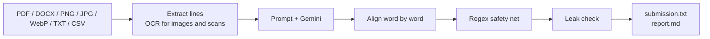
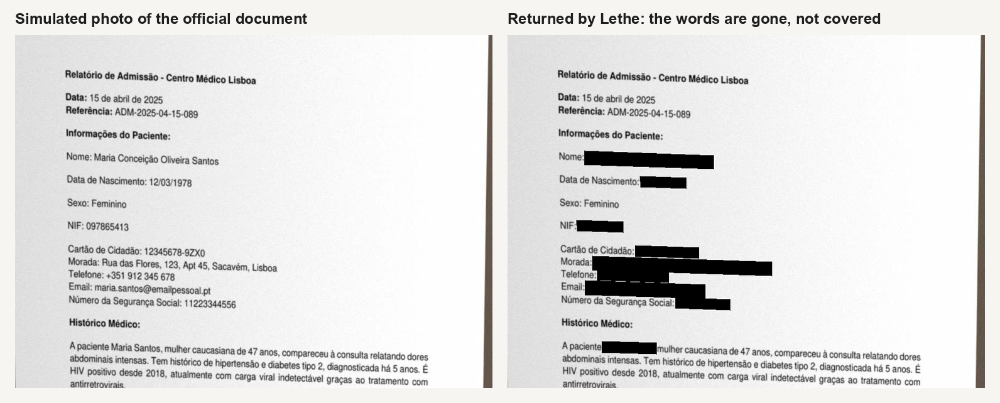
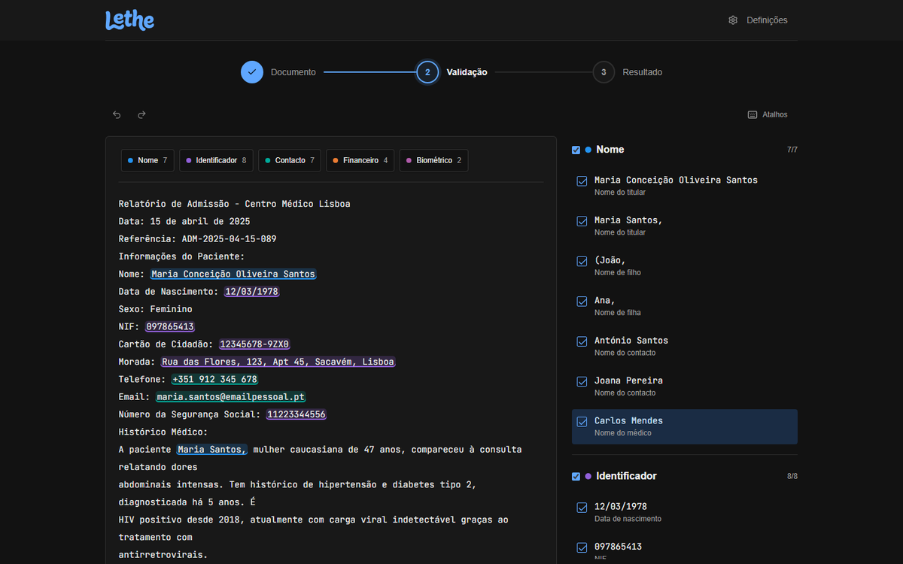

# Lethe: anonymising Portuguese documents with an LLM

Team **Enxada de Pedra**, NOS challenge "Call for Anonymizing Prompts", JunctionX Lisbon 2026.

Lethe masks the words that identify a person in a Portuguese document. It uses one `*` per word, keeps the original layout and removes empty lines. A reviewer can check every decision and why it was made, and the system checks that nothing it masked is still readable. Gemini decides what is sensitive; plain, tested code guarantees the format and the safety.

> `submission/README.md` holds the organisers' guidelines and is left untouched. This file documents our solution.

## Results

| | Value |
|---|---|
| Official document, Similarity (local metric) | 100% |
| Official document, Accuracy (local metric) | 100% |
| Leak check on the official document | 0 leaks in 26 masked values |
| Words masked in the official document | 52, in 28 explained items |
| Extra test documents | 17 (PDF, TXT in UTF-8 and UTF-16, CSV), 961 words masked, 0 errors |
| Tilted photos of the official document (-5 to +5 degrees, no page border) | 306 of 315 sensitive words read by OCR (251 before the tilt correction) |
| Python tests | 213, coverage 96% (gate 90%) |
| Web frontend tests | 55 |
| Mobile app tests | 31 |

The local metric (`anonimizador/metric.py`) reproduces the two figures of the official evaluation logs:
- **Similarity:** the share of words identical to the reference.
- **Accuracy:** the share of sensitive words fully masked.

The reference (`data/gold/gold.txt`) was annotated by hand under the policy below, and `submission.txt` and `prompt.txt` are exactly what `python run.py` generates today. Since the rules forbid intermediate submissions, the official score is unknown until the final evaluation.

## What is masked

The policy follows the mentors' answers: **mask what can make the person identifiable, and keep the rest of the document.** A profession on its own does not identify anyone, but together with the name of the place where the person works it does, so the profession stays and the workplace goes.

| Masked | Kept visible |
|---|---|
| Names of every person (patient, relatives, contacts, professionals), including first names on their own | Clinical content: symptoms, diagnoses, HIV status, medication, results |
| Date of birth | Characteristics that do not identify anyone on their own, such as sex, ethnicity, age or profession |
| ID numbers: NIF, Cartão de Cidadão, NISS, health number, insurance policy, professional licence, biometric IDs | The document's date and reference (`ADM-2025-04-15-089`) |
| Full address, with postal code and town | Years of past events |
| Workplace or school of a person (the name of the company or institution) | |
| Declared salary or income (the value) | |
| Phone numbers and emails, also professional ones | The institution that issues the document (in its title), room and class numbers, grades |
| Payment data: card number, expiry date, CVV, IBAN, account number | |
| Credentials, IP addresses, GPS coordinates | |

## How it works



1. **Extract** (`extract.py`): PyMuPDF reads the PDF. Text files are decoded as UTF-16 (BOM), UTF-8 or Windows-1252. Trailing spaces and empty lines are removed.
2. **Ask the model** (`prompt.py`, `llm.py`): the prompt numbers every line. Gemini answers in JSON with the masked lines plus one explanation per masked value (category, whose data it is, reason).
   - Answers are cached on disk by a SHA-256 of model, temperature and prompt, so repeated runs cost nothing.
   - Rate limits (429/503) and network errors are retried.
   - An invalid answer is retried at temperatures 0.0, 0.3 and 0.6 and is never cached.
3. **Align** (`align.py`): the model's lines are compared with the original word by word (`difflib`). Only "word becomes `*`" changes are accepted, so the model can never rewrite, add or drop text. An answer that loses more than 20% of the words is rejected.
4. **Safety net** (`safety.py`): regular expressions mask identifiers the model missed:
   - emails and Portuguese phone formats;
   - IBANs of any country, checked by length, even when split across lines;
   - Cartão de Cidadão numbers;
   - IP addresses after an "IP" label;
   - GPS coordinates;
   - labelled student and employee numbers.

   Words are NFKD-normalised first, so styled Unicode letters and struck-through text are caught too.
5. **Leak check** (`verify.py`): every masked value is searched for again in the final text. The run prints `Leak check: 0 leaks in 24 values checked`.
6. **Report** (`report.py`): groups masked words into items with category, owner, reason and source (model or safety net). The shared `report.md` hides the original values.

### The prompt

`prompt.txt` is the exact prompt used for `submission.txt`. A test checks that it is identical to `build_prompt(lines, "A")`. It combines:

- **Role:** a data protection officer who knows the GDPR and Portuguese documents.
- **Policy:** an explicit list of what to mask and what to keep, matching the table above.
- **Doubtful cases:** a self-test ("does this data, on its own, tell who the person is or how to contact them? If so, mask it").
- **Format rules:** one `*` per word, and identifiers split across lines or struck through are still identifiers. The prompt asks the model for a bare `*` (`Flores,` -> `*`); the alignment code then puts back the punctuation glued to the word (`Flores,` -> `*,`), so the layout of the document is kept. This is a code step after the model, not an instruction in the prompt, and `run.py --no-keep-punct` gives the bare form.
- **Open question:** whether the hidden reference writes `Flores,` as `*,` or as `*` is not known; it changes 9 words of the official document. The reference in `data/gold/gold.txt` keeps the punctuation, like `submission.txt`, and the local metric counts both forms as censored.
- **Worked example:** a short example that is not taken from the evaluated document.
- **Self-check list:** what the model must verify before answering.
- **Structured output:** JSON, so every decision comes with its explanation.
- **Context hints:** for school and similar documents, detected from the text (`context.py`).
- **Determinism:** temperature 0.

Variant B also masks ages. It exists to compare scores and is not the submitted one.

The worked example includes a relationship word that stays visible ("(irmã)"): without it, the model started masking "(irmão)" and "(amiga próxima)" once the workplace rule was added.

## Other formats and redacted files



Besides the challenge PDF, Lethe reads scanned PDFs, photos and images (PNG, JPG, WebP), DOCX, TXT and CSV. Every input still produces `submission.txt` and the report through the same pipeline. Images, PDFs, DOCX and CSV files also come back redacted, in their own format (`python run.py --pdf FILE --redact`, or `GET /api/documents/{id}/download/redacted`). A CSV is read cell by cell: each row becomes a line with the cells separated by the delimiter on its own, so every value is its own item, the separators are never masked, and the redacted file is the CSV again with the masked cells. Several files can go at once: `POST /api/documents/batch` takes up to ten in one request and answers for each one, the web app opens a tab per document, and `POST /api/documents/zip` returns every output in one archive.

- **Images and scans:** they are read by [Tesseract](https://github.com/tesseract-ocr/tesseract) on the machine, in Portuguese, so the image never leaves it; only its text goes to the model. Each word keeps its box.
  - The redaction paints opaque black over the masked words. It never blurs or pixelates, since those can be reversed. The boxes are padded so accents and descenders are covered too.
  - The image is rebuilt from its pixels only and saved as PNG, so EXIF data (GPS, the embedded thumbnail), XMP and text chunks are gone.
  - A scanned PDF is rebuilt from the redacted page images only.
  - The pages of a scanned document are read up to three at a time (a rendered page is about 26 MB, so no more). A two-page scan went from 16 s to 8 s with the model answer cached, and the result is identical to reading them one by one.
- **Phone photos:** the page is found in the photo and flattened (perspective correction) and its lighting is evened out before OCR. When there is no visible page border (a cropped photo, or a light page on a light table), the tilt of the text lines is estimated and corrected instead (`deskew.py`); the boxes found on the levelled page are mapped back onto the photo the same way. The bars are then mapped back onto the original photo as polygons that follow the slant of the text. Before anonymising, the model fixes OCR misreads ("Financelras" becomes "Financeiras", "OVV" becomes "CVV"). The fixes are taken word by word, and only when a line keeps its word count and each word stays close to what OCR read, so every word keeps its place in the image and no name or number can be swapped. Two real phone photos of the official document (taken of a screen, in perspective) give text **identical to `submission.txt`**: 60/60 lines, 100% Similarity and Accuracy.
- **OCR misreads:** OCR words read with low confidence that look like identifiers (3 or more digits, `@` or a domain) are masked as a precaution. OCR can turn `maria@x.pt` into `mariaQx.pt`, which neither the model nor the patterns would recognise.
- **Text OCR could not read:** ink left outside every word box that has the shape of a text line means text that was never checked. The backend first reads that strip again as a single line (Tesseract page layout analysis sometimes drops a whole line of a photo, even the patient's name) and widens the box of words whose ink stuck out; only what still cannot be read is left over. A long word read with low confidence is kept (an email read as `name(&host.pt`), while a short one at that confidence is treated as noise. The backend refuses the redacted file (`redactable` is false and `download/redacted` answers 422); only `submission.txt` and the report are given, and the interface shows how many lines were skipped and asks for a sharper photo.
- **Text PDFs:** PyMuPDF redactions delete the text, image pixels and drawings under each word. Hidden text, metadata, attachments, JavaScript, links and form data are scrubbed, and the file is saved in full, never incrementally.
- **DOCX:** masked words are rewritten inside the runs, so formatting is kept. This covers the body, tables, headers, footers and footnotes. Tracked changes are resolved, and comments, images, embedded objects and author fields are removed.
- **Fail closed:** every redacted file is read back by an independent check before it is returned:
  - a new OCR pass on images, and pure-black pixels inside every box;
  - the extracted text and internal objects of PDFs;
  - every XML part of DOCX files;
  - no metadata in any of them.

  If a word cannot be located or the check finds anything, no file is returned, only the text.

## Review interface



`frontend/` is the review screen, built with Lovable and connected to the API. It lets you:

- **Load a document:** import a PDF, DOCX, image (PNG, JPG, WebP), TXT or CSV, or paste text.
- **Review the items:** see every item highlighted by category with its reason, keep any of them visible or mask extra words by selecting them, and undo or redo each change.
- **Compare and download:** compare the original and the anonymised text (or, for PDFs and photos, the pages with black bars, side by side or under a slider), then download `submission.txt`, the report and, for PDF, DOCX, CSV and images, the redacted file.

Backend items are masked at the exact positions the backend found. The frontend's output equals the backend output byte for byte, which was checked on the official document.

Keyboard: `J`/`↓` next item, `K`/`↑` previous item, `Enter` or `Space` toggles the item, `Ctrl+Z` undo, `Ctrl+Shift+Z` redo.

Without `VITE_API_URL` the interface runs in demo mode with simulated results, and says so in the header.

## Mobile app

`mobile/` is an Expo (React Native) app for Android and iOS: photograph a document or pick a file, review what was masked, and share the anonymised text, the report or the redacted file. It reuses the web code for the position-based mask, the review history, the API model and the 8 languages, so both interfaces behave the same. Run it with `npx expo start --tunnel` (see `mobile/README.md`).

### Privacy by design

- Documents live only in the API's memory, with no database and no files; the API does not cache the model's answers either, since they quote the document. At most 30 are kept (the least recently used goes first), one idle for 30 minutes is dropped, and `DELETE /api/documents/{id}` removes one at once. Ids are 22 random characters.
- Uploads are checked before any heavy work: at most 25 MB; a DOCX that unpacks past 50 MB, an image over 80 megapixels, a scanned PDF over 20 pages or a document over 8 000 words is refused (413) before any model call, and a binary file named `.txt` is refused as unsupported (415). The routes that take several documents at once (`/batch`, `/zip`) are rate limited per client (429 with `Retry-After`).
- `run.py` (the command line) does cache the model's answers in `data/cache/`, so repeated runs cost nothing. That folder is not committed, but it holds the documents' text: delete it after working with real documents.
- Request logging is off, and document text never appears in logs or error messages.
- The browser only stores the theme and the language.
- Only the text is sent to the model. The API key stays in `submission/.env`, which is never committed.
- With a local model (`LLM_PROVIDER=ollama` or `openai` in `.env`) the text never leaves the machine; the interface can read `GET /api/health` to tell which it is.
- `ask.py` and `POST /api/documents/{id}/ask` show a pseudonymisation gateway: identifiers are replaced by placeholders such as `[PESSOA_1]` before a question reaches the model, then restored in the answer.

## Setup

Requirements: Python 3.10+, Node.js 22.12+ (TanStack Start, used by the web interface, needs it) and a Gemini API key, or a local model through [Ollama](https://ollama.com) or any OpenAI-compatible server (see `api/README.md`, "Local models"). For images and scanned PDFs, also [Tesseract](https://github.com/UB-Mannheim/tesseract/wiki) with Portuguese (`apt install tesseract-ocr-por` on Linux; on Windows, the UB-Mannheim installer, or `por.traineddata` in `%LOCALAPPDATA%\tessdata`).

```bash
cd submission
pip install -r requirements.txt
cp .env.example .env            # then set GEMINI_API_KEY in .env
# or run fully offline: ollama pull gemma3:12b, and LLM_PROVIDER=ollama in .env
```

## Usage

```bash
# 1. Generate submission.txt, prompt.txt and report.md from the official PDF
python run.py                    # options: --pdf, --model, --variant A|B, --no-keep-punct

# 2. Start the API (docs at http://localhost:8000/docs)
uvicorn api.main:app --port 8000 --no-access-log

# 3. Start the review interface (http://localhost:8080)
cd frontend
cp .env.example .env             # VITE_API_URL=/ proxies /api to the API
npm install
npm run dev

# 4. Optional: the mobile app (Expo Go on the phone)
cd ../mobile
npm install
npx expo start --tunnel
```

Other commands:

```bash
python -m anonimizador.metric submission.txt data/gold/gold.txt   # local score
python -m anonimizador.evaluate_docs data/test_docs               # 17 extra documents
python data/test_docs/make_photos.py                              # rebuild the 6 test photos
python ask.py "Que medicação toma a paciente?"                    # gateway demo
python -m pytest                                                  # Python tests
cd frontend && npm test                                           # web tests
cd mobile && npm test                                             # mobile tests
```

## Repository layout

```
submission/
├── submission.txt        output for the official document (deliverable)
├── prompt.txt            exact prompt used (deliverable)
├── report.md             what was masked and why, values hidden
├── run.py                generates the deliverables
├── ask.py                pseudonymisation gateway demo
├── anonimizador/         pipeline: extract, prompt, llm, align, safety, verify, report, metric
├── api/                  FastAPI backend for the review interface (see api/README.md)
├── frontend/             web review interface (see frontend/README.md)
├── mobile/               Expo app for Android and iOS (see mobile/README.md)
├── data/gold/            hand-annotated reference for the official document
├── data/test_docs/       17 fictitious documents and 6 test photos (see its README)
├── tests/                pytest suite
└── PROJECT.md            this file
```

## Decisions and limitations

- **The LLM decides, the code guarantees.** The model only chooses what to mask. Alignment, the safety net and the leak check make sure the format is right and known identifier patterns never get through.
- **Model choice:** `gemini-3.1-flash-lite` answers in about 5 to 6 seconds per document and reaches 100% on the reference. That time is the answer itself (about 2 500 output tokens: the model returns the masked lines and one explanation per item), not hidden reasoning: the model reports no thinking tokens, and turning thinking off gave identical output on three documents. `gemini-3.8-flash` took 12 to 15 seconds per call and hit rate limits more often. For documents that may not leave the building, `LLM_PROVIDER=ollama` runs the same prompt on a local model (`gemma3:12b` by default); the alignment, safety net and leak check are the same, so a weaker model costs recall on context-dependent identifiers, never format or known patterns.
- **Prompt changes are measured, not assumed:** rewording one rule ("keep the name of the institution that issues the document") left the official output identical, but on the 17 extra documents it changed 6 of them: it masked a missed surname and an ID card expiry date, yet left parts of two personal addresses and two personal amounts visible. The model is deterministic here (two runs of the old prompt give the same output), so the change came from the wording. It was rejected.
- **No database:** documents are sensitive by definition, so nothing is stored.
- **Limitations:**
  - a blurry or strongly tilted photo can leave a line the OCR cannot read; the redacted file is then refused rather than delivered with that line visible, and only the text output is given;
  - the test photos are made from the official PDF (blur, noise, tilt, JPEG), not taken with a phone, so real photos can do worse;
  - the test documents are cleaner than real ones;
  - context-dependent identifiers without a pattern (a nickname, a rare job title in a small town) rely on the model alone.
- **Next steps:**
  - real phone photos, to tune the OCR and the tilt correction;
  - more real, annotated documents to measure recall;
  - per-organisation policies for what counts as identifying.

## Deployment

| Part | Where | Address |
|---|---|---|
| Web interface | Vercel, project `lethe-enxada-de-pedra` | [lethe-nos.vercel.app](https://lethe-nos.vercel.app) |
| Android app | EAS Build, profile `preview` (an installable APK) | [APK](https://expo.dev/artifacts/eas/senh9mrlPdfxIErtZ4JFmHEVLVfnFGpDv3ipADKZTIg.apk) |
| API | A team computer, exposed by a Cloudflare quick tunnel | changes when the tunnel restarts |

The API needs Tesseract and the Gemini key, which do not fit a static host, so for the event it runs on a team computer: `uvicorn api.main:app --port 8020` behind `cloudflared tunnel --url http://127.0.0.1:8020`. `ALLOWED_ORIGINS` lists the web addresses that may call it, and the documents still stay in that process's memory only.

- **Web:** `VITE_API_URL` is read at build time, so the web is built with the tunnel address: from `frontend/`, `vercel deploy --prod --build-env VITE_API_URL=<tunnel URL>`.
- **Android:** the address is the EAS environment variable `EXPO_PUBLIC_API_URL` (environment `preview`), not a file in the repository; from `mobile/`, `eas build -p android --profile preview`. If the tunnel address changes, type the new one in the app's Settings instead of rebuilding.
- **Limits of this setup:** it works only while that computer and the tunnel run, and anyone with the link can use the API (and the team's Gemini quota) until it is switched off; the upload limits above still apply. A permanent deployment would put the API in a container with Tesseract on a cloud host.
- **iOS:** not built, since it needs a paid Apple developer account.

## Performance

Measured on a photo of the official document: about 10 s to upload (OCR 2.5 s, model 5.5 s, the rest is fixed work) and 3 s to build and verify the redacted file. The model is the largest part and only shrinks by changing the prompt format, which would change the deliverable.

For text documents the work outside the model takes under 30 ms. For photos and scans it was measured stage by stage (model stubbed, so only the local work counts) and the waste removed, with the OCR output checked to be identical on every test photo and scan:

| Document | Upload, local work | Redacted file | After | |
|---|---|---|---|---|
| Phone photo, 12 MP, tilted | 6.8 s | 5.1 s | 3.4 s and 3.1 s | the file is ready when the review is, so the preview and the download take 5 ms |
| Scan at 300 dpi | 4.3 s | 2.2 s | 2.1 s and 1.6 s | |
| Scanned PDF, 2 pages | 3.4 s | 6.0 s | 1.9 s and 2.6 s | |
| Text of 8 000 words (the limit) | 2.6 s | | 0.6 s | |

What was tried:

| Idea | Result | Used |
|---|---|---|
| Read the pages of a document in parallel | 2-page scan 16 s to 8 s, identical result | yes |
| Cut a page into bands read at the same time | OCR 48% faster, but 134 against 135 sensitive words read and twice the unread zones | no |
| Enlarge the image less before OCR | 25% faster, one word lost | no |
| One Tesseract thread | slower | no |
| Tesseract options (`--oem 1`, no inverted pass, uncompressed temporary image, image on stdin) | no gain, or slower | no |
| Even the page's light once per page instead of three times (OCR, unread-line search, again after recovery) | identical result, 0.3 s less per page | yes |
| Running maximum instead of a 1 x 30 binary dilation in the unread-line search | identical pixels, 5x faster (0.4 s to 0.07 s per call, two calls per page) | yes |
| PNG compression level 3 instead of 6 for the redacted photo | half the encoding time, file 7% larger | yes |
| Build the redacted file in the background as soon as the review is known, and reuse it | the preview and the download of the same review share one build; a new review starts a new one | yes |
| One model client per configuration instead of one per call | the connection is reused by the two calls an OCR document makes | yes |
| Normalise the model's entities once per report, and diff the answer once for the validation and the alignment | 8 000-word text 2.6 s to 0.6 s | yes |
| Scanned PDF page inserted from pixels instead of a PNG stream | 5% on a 300 dpi page | no |

## Team

Pedrom2002, TAF00, RicePerson101 and euick0 (Eric Golovatenko Simões).

## References

Models and services:
- [Google Gemini API](https://ai.google.dev/gemini-api/docs) (`gemini-3.1-flash-lite`) through the [google-genai](https://github.com/googleapis/python-genai) SDK
- [Ollama](https://ollama.com) ([API](https://github.com/ollama/ollama/blob/main/docs/api.md)) and the [OpenAI chat completions API](https://platform.openai.com/docs/api-reference/chat) for local models (`gemma3`, `llama3.1`, LM Studio, llama.cpp, vLLM)

Python:
- [PyMuPDF](https://pymupdf.readthedocs.io/): PDF text extraction
- [FastAPI](https://fastapi.tiangolo.com/), [Uvicorn](https://www.uvicorn.org/) and [python-multipart](https://github.com/Kludex/python-multipart): API
- [HTTPX](https://www.python-httpx.org/): network error handling
- [python-dotenv](https://github.com/theskumar/python-dotenv): API key loading
- [pytest](https://docs.pytest.org/), [pytest-cov](https://pytest-cov.readthedocs.io/) and [flake8](https://flake8.pycqa.org/): tests and lint
- [difflib](https://docs.python.org/3/library/difflib.html) (standard library): word alignment
- [Tesseract OCR](https://github.com/tesseract-ocr/tesseract) through [pytesseract](https://github.com/madmaze/pytesseract): reading images and scans
- [Pillow](https://python-pillow.org/): image redaction
- [NumPy](https://numpy.org/) and [SciPy](https://scipy.org/): page detection, perspective and lighting correction
- [python-docx](https://python-docx.readthedocs.io/): DOCX reading and redaction

Frontend:
- [Lovable](https://lovable.dev/): first version of the interface
- [React](https://react.dev/), [TypeScript](https://www.typescriptlang.org/) and [Vite](https://vite.dev/)
- [TanStack Start, Router and Query](https://tanstack.com/)
- [Tailwind CSS](https://tailwindcss.com/), [shadcn/ui](https://ui.shadcn.com/) on [Radix UI](https://www.radix-ui.com/), [lucide](https://lucide.dev/) icons and [Sonner](https://sonner.emilkowal.ski/) toasts
- [pdf.js](https://mozilla.github.io/pdf.js/): reading PDFs in the browser
- [Vitest](https://vitest.dev/) and [Testing Library](https://testing-library.com/): tests
- [Inter](https://rsms.me/inter/) and [JetBrains Mono](https://www.jetbrains.com/lp/mono/) fonts through Google Fonts

CI: [GitHub Actions](https://docs.github.com/actions), used in the team fork only.
